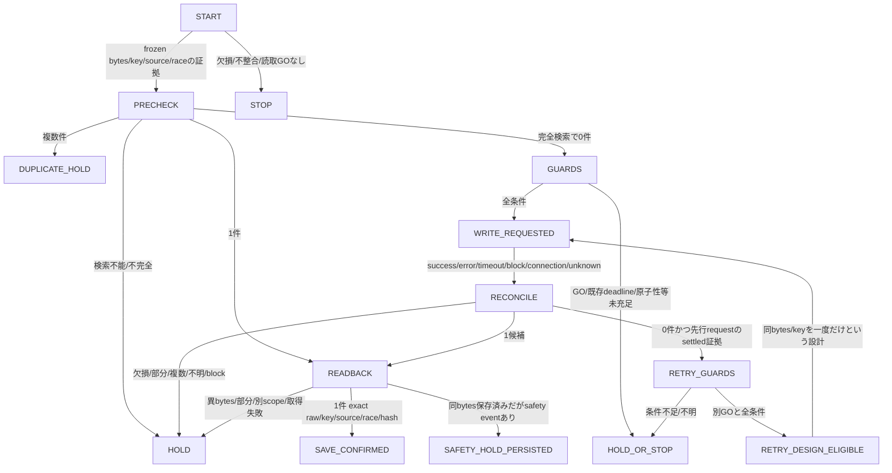

# SYS-01 状態遷移とexact retryの設計候補

設計・合成fixtureのみ。既存writer/LOCK/予想ルールの記述だと認定しない。

正確な33遷移は`state-machine.json`。図は要約。検証器は宣言経路を読むだけで遷移・書込を実行しない。

## 独立して記録するもの

1. 保存応答：HTTP_SUCCESS / HTTP_ERROR / TIMEOUT / SAFETY_BLOCK / CONNECTION_FAILURE / UNKNOWN_RESPONSE。
2. 実体：一意な同scope同raw bytes/hashの保存確認、観測時点の不在、未確認、部分、重複、競合。
3. exact retry：DENY、または別GO等がすべて揃った設計上の候補。現在の実行許可は常にNONE_DESIGN_ONLY。

HTTP successだけで保存確定にしない。timeout/エラーでも保存済みならreadbackで確認し、重複writeをしない。
`save_confirmed_unique_exact`は一意で完全な保存の証拠の有無。nullは未確認/異常であり「未保存」の断定ではない。
`persistence_unverified`は保存軸だけ。safety-block保存済みの場合、保存は確認できてもsafety審査はOPENでretry不可。
保存の確認はその観測時点に限定され、将来の重複、時刻真正性、LOCK有効性の保証ではない。

## 不変のFrozenEvidence

入力は既に凍結された予想raw bytes、SHA、race、source、idempotency key。ここでは予想を作らず、再計算/再シリアライズしない。
保存前は同scope/keyを完全検索する。検索失敗/ページ送り未完了と0件を区別する。
1件候補は実保存フィールドのraw bytesをreadbackして照合する。外側のHTTP JSON表現のbytesと混同しない。
実保存の原bytesを取得できずparse済objectしか得られない場合はcanonical再構成でexact確認したとしない。
同key1件同bytesは保存確認で新write不要。複数件は同bytesでもHOLD、異bytesなら競合も併記し上書きしない。
別source/race/keyの結果はscope不一致。相手系統の予想を取得・利用せずHOLDする。
部分保存はcomplete成功とせず、欠損を補って再保存しない。

## exact retryの非採択候補

上限案はinitialを含む総試行2回（retryは最大1回）。正式値はOPEN、未採択なら自動retry不可。
送信を試みた回は応答不明でも試行として数え、成功していないと推測してcounterを戻さない。
以下が全て必要：

- 元raw bytes/hash/key/race/sourceが完全保持され同一。新しい予想やkeyを作らない。
- スコープ付き検索が成功し、全ページが揃い、先行writeがsettledした後の不在証拠がある。
- 同時実行/遅延commitに対する原子的一意キーまたはidempotent sinkの保証が審査で立証済み。
- 既存のdeadline/Freeze gateが現時点でPASS。UNKNOWN/時刻不明はSTOP。猶予・新しい有効性ルールは定義しない。
- 当日race×source×時刻×exact retry行為を明記したアンディの別GOと回数余裕。
- safety-blockや未解決の権限拒否を迂回しない。

検索0件だけでは、timeoutした元writeの遅延commitを除外できない。read-then-createも原子操作ではない。
保存先のunique key保証を仮定しない。Airtable等の実能力は未照会で、無ければHOLD/別設計・別審査。
初回保存を含む本設計を統合するには既存writerの二重登録防止契約も必要。現在のA/B保存をこの案で勝手に止めたり差替えたりしない。
safety-block時は許可された独立readbackで既存保存の有無を確認できる場合だけ記録し、write/replayの抜け道を作らない。
結果後に予想/LOCKを修正しない。遅いreadbackで保存が見つかっても締切前LOCKの有効性は別判定のまま。

## fixtureの時点

`guards`はINITIAL/RETRY/READBACK_OR_PRECHECKと明示した判断時点のsnapshot。
過去のwrite intentにはその時点の既存deadline verdict/GO/原子性証拠をSYNTHETICとして記録する。
retry時の時計/GOが後で失効しても過去writeの事実を作り替えない。実時刻・実GOを今回生成したわけではない。
同bytesを2回送る例も設計intentの一覧だけで、API呼出しは0回。

## 人の介入と復元

HOLD/STOPは追加writeを止める意味で、キャンセル/削除/修復/replayを許さない。
当日race/source、実観測時刻、actor、観測証拠、行為、GOを私的な介入台帳に記録する手順を将来審査する。
その台帳の保存先/schemaも本件で変更しない。資格情報/実予想/実ログを公開repoへ置かない。
既存A/Bへの変更なし。復元すべき旧新本文は未作成。後日の統合にはHQ14照合live原本を私的に封印し、予想決定sectionの旧新byte同一証明を必要とする。
証明が欠ける、予想/重み/LOCK/締切/Freezeに影響する場合はLane2/HOLD。
